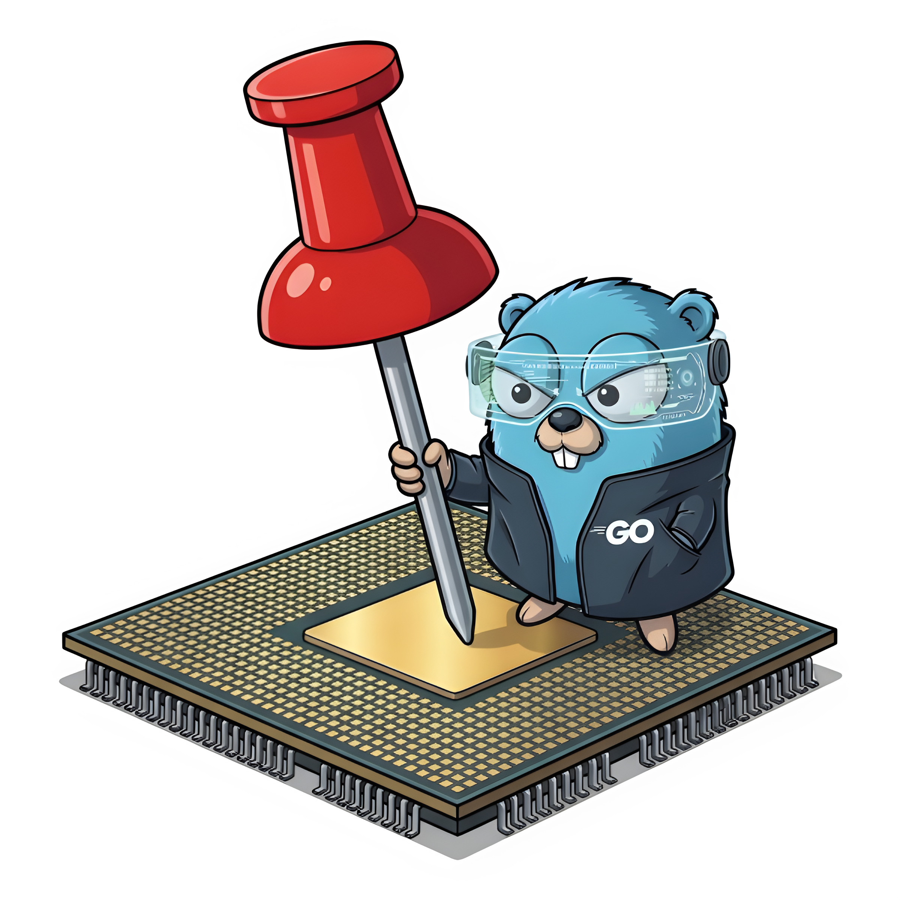

[](LICENSE)


GOSET : Noise-aware CPU pinning
============================================



Goset is a systematic CPU-pinning CLI tool. It pins a single or multi threaded task to the quietest cores, and reports the kernel counters of the run.

* **Noise-aware:** Ranks CPUs by IRQ rate and scheduler load before pinning.
* **Isolated:** cgroup v2 + IRQ steering, for exclusive CPU access.
* **Telemetry:** IRQ, throttle, ctxsw counts, CPU frequency, migration.
* **No IPI:** The housekeeper thread reads every CPU's counters remotely via kernel managed counters.
* **Diagnostics:** Reports topology, environment, existing cgroups.

Table of Contents
-----------------

* [Quick Start](#quick-start)
* [Technical insights](#technical-insights)
* [Performance results](#performance-results)
* [Contributing](CONTRIBUTING.md)
* [AI Policy](AGENTS.md)
* [License](LICENSE)


Quick Start
-----------

Goset needs sudo only for `-cgroup` and `-steer`.

| flag | type | default | description | rule |
|---|---|---|---|---|
| ` -- ` |string| | Separating Goset flags and task | |
| `-n` |int| 1 | How many threads to book | n>=1 |
| `-cgroup` |bool| false | Containerize task inside Cgroupv2, holds tasks that reset their own affinity | **sudo** |
| `-fence` |bool| false | Books the SMT siblings of the selected CPUs in the cgroup, idle. | **sudo**, `-cgroup` |
| `-steer` |bool| false | Push away steerable IRQs, automatically handle IRQBalance | **sudo** |
| `-interval` |int| 100 | Poll interval in milliseconds for telemetry collection | |
| `-include` |string| | List of threads to select first, handles ranges (e.g.: `1,3-5` -> 1,3,4,5)| |
| `-exclude` |string| | List of threads to avoid, handles ranges (e.g.: `1,3-5` -> 1,3,4,5) | |
| `-numa` |int| -2 | Constrain the task cpus and memory to one node: 0..N that node only, -1:Auto (widest node), -2:Off (multi node). A node that cannot fill `-n` is an error. | |

> Telemetry: `0` reads the same for no activity, no kernel support and nothing sampled. A failed read ends the report in an `Errors` table, one line per failure.

Goset has a second form called `Diagnostic`, callable with bare `goset`.

| flag | description | rule |
|---|---|---|
| *bare* | Report Topology, CPU state, cgroups.. | | 
| `-rm-cgroup` | Let you **brut-force delete** an existing group. In case of non-identified goset bug | **sudo** |

> Identifying Goset's cgroup: name is "goset-" + the task binary's basename (e.g. task: `./mybench arg1, arg2` -> cgroup name: `goset-mybench`).

**Real usage**:
```bash
# Pin to one quiet CPU
goset -n 1 -- ./task

# Request 4 threads with full isolation
sudo goset -n 4 -cgroup -steer -fence -- ./task

# Steer selection toward 2,4,5,6 and avoid 0 and 1 for remaining N
goset -n 5 -numa 0 -include 2,4-6 -exclude 0,1 -- ./task

# Change the telemetry sampling window
goset -interval 500 -- ./task

# Remove a cgroup goset left behind (in case of bug)
sudo goset -rm-cgroup goset-mybench
```

**Output** (with `-cgroup`, `-steer` and `-fence`):
```
----------------- GOSET -----------------
Selection
  cpu  sel  steer  non-steer  core  sibl  isol  numa  nohz  rcu
    3   *       0         20   232     9           0
    9   *       0        212   232     3           0
    6   *       0          3   253     0           0
    0   *       0        250   253     6           0
    5   *       0        126   318    11           0
   11   *       0        192   318     5           0
    2   *       0         47   349     8           0
    8   !       0        302   349     2           0
   10   &       0        143   439     4           0
    4           0        296   439    10           0
    1          11        161   479     7           0
    7         278        318   479     1           0

Telemetry
  cpu  freq min  freq avg  freq max  throttle count  irq steerable  irq non-steerable
  0     2.99GHz   4.69GHz   5.20GHz               0              0              1.33k
  2     2.99GHz   4.86GHz   5.45GHz               0              0              1.24k
  3     2.99GHz   4.39GHz   5.20GHz               0              0              1.02k
  5     2.99GHz   4.78GHz   5.45GHz               0              0              1.27k
  6     2.99GHz   4.83GHz   5.20GHz               0              0              1.24k
  9     2.99GHz   4.75GHz   5.20GHz               0              0              1.27k
  11    2.99GHz   4.98GHz   5.45GHz               0              0              1.48k
  all   2.99GHz   4.75GHz   5.45GHz               0              0              8.84k

Run
  task            sched                   steer
  poll  3736@1ms  ctxsw vol            8  applied         40
  wall    3.754s  ctxsw invol         70  rejected        26
  util      579%  migrations           5  remaining        1
  exit         0  run_delay     28.690μs  drift            0
                                          irqbalance  absent
```

Selection columns:
* `sel`: `*` task cpu, `&` housekeeper, `!` fenced sibling (`-fence`).
* `steer`, `non-steer`: interrupts counted on the cpu during the 500ms ranking sample. Steerable ones can be moved away, non-steerable (NMI, LOC, RES) cannot.
* `core`: rank cost, this cpu's noise plus its sibling's. Steerable interrupts count only without `-steer`.
* `sibl`: SMT sibling cpu, `-` when alone.

The other tables: `Telemetry` holds per-cpu counters over the run, `Run` holds wall time, `util` (cpu time over wall, 100% is one busy thread), exit code, scheduler, steer and drift counters.

Technical insights
-------------

**Selection** (`internal/cpu/bench.go`)
- Sort threads by noise, pick best thread from best core, then select remaining threads from core.
- The task takes the top cpus, the housekeeper the next one outside the task's core.
- With `-fence`, the siblings of the task cpus are booked idle while a cpu stays free for the housekeeper and, with `-steer`, for the IRQs.

**Isolation**
| mode | mechanism | scope |
|---|---|---|
| default | `sched_setaffinity` | N threads, shared mask |
| `-cgroup` | cgroupv2 cpuset, placed at clone (`CLONE_INTO_CGROUP`) | N threads |

Without `-cgroup`, the CPU mask is inherited by every thread the task starts. A task that resets its own affinity (OpenMP, MPI) escapes it.

With `-cgroup`, the cpuset holds the task CPUs plus their SMT siblings (`-fence`), and the task is pinned to the task CPUs by `sched_setaffinity`.

**IRQ steering** (`-steer`)
- The kernel routes every IRQ to a cpu, so the IRQs belong on a cpu the task does not run on.
- Writes `/proc/irq/*/smp_affinity_list`, restores the prior affinity on exit.
- `irqbalance` rebalances against that on its own schedule, so it is held for the run: unit stopped, restarted on exit.

**Telemetry**
- Reader: Remote thread, external to task.
- No IPI: a counter read that interrupts the task measures the reader.
- Source: `/proc/interrupts`, sysfs throttle, `wait4()` rusage.
- Errors: a failed read does not abort the report, it is collected.


Performance results
--------------------

Setup: Ryzen 5 7600X (6 cores, SMT on), 10 interleaved runs per mode, 5s idle before each run. `baseline` is the bare binary, `taskset` is `taskset -c` on one rotating CPU, `goset` is `-n 1 -cgroup -steer -fence`.

Benchmarks:
- jitter: xorshift-multiply chain, exposes CPU time lost to interrupts and preemption.
- chase: loads over a 192 KiB ring that fits L2, exposes core migration and cache pollution.
- matmul: 32x32 double matrix multiply, exposes CPU frequency and sibling-thread interference.
- stream: STREAM Triad over 20M-element arrays, exposes memory-bandwidth variation.

**jitter** (ms per iteration, lower is better)

| mode | median | sd | min | max | spread |
|---|---|---|---|---|---|
| baseline | 5.05 | 0.059 | 4.98 | 5.14 | 3.2% |
| taskset | 5.14 | 0.059 | 5.00 | 5.17 | 3.3% |
| goset | 5.00 | 0.042 | 4.96 | 5.10 | 2.8% |

**chase** (ns per load, lower is better)

| mode | median | sd | min | max | spread |
|---|---|---|---|---|---|
| baseline | 2.61 | 0.05 | 2.52 | 2.70 | 6.9% |
| taskset | 2.63 | 0.04 | 2.59 | 2.70 | 4.2% |
| goset | 2.54 | 0.02 | 2.51 | 2.56 | 2.0% |

**matmul** (MFLOP/s, higher is better)

| mode | median | sd | min | max | spread |
|---|---|---|---|---|---|
| baseline | 17241 | 597 | 15803 | 17689 | 10.9% |
| taskset | 16556 | 736 | 14856 | 17434 | 15.6% |
| goset | 18191 | 336 | 17134 | 18352 | 6.7% |

**stream Triad** (MB/s, higher is better)

| mode | median | sd | min | max | spread |
|---|---|---|---|---|---|
| baseline | 40826 | 363 | 40182 | 41367 | 2.9% |
| taskset | 40645 | 395 | 40136 | 41415 | 3.1% |
| goset | 41156 | 233 | 40896 | 41799 | 2.2% |

> `spread` is (max - min) / median

Limits: taskset changes core every run, so its spread includes core-to-core differences.

Reproduce: `sudo goset-bench -bench jitter -runs 10 -n 1 -settle 5s -fence=true -taskset=true`.

### Your own task

`goset-bench` runs any command after `--` in each mode, 10 interleaved runs by default, and compares the numbers the task prints.

```
sudo goset-bench -runs 10 -n 1 -settle 5s -taskset=true -- ./mytask arg1 arg2
```

- Every number in the task's output becomes a metric, keyed by its line label and column.
- `-dump` prints the extracted keys. `-match REGEX` selects keys. `-topk N` caps the keys shown (default 8).
- A task that exits non-zero has its run discarded.
- The task must print the same line structure every run. A changed structure raises an `output drift` warning.

> An unusual output format can yield wrong metrics. Open an issue with a sample of it.


License
-------

Apache-2.0. Copyright 2026. See [LICENSE](LICENSE).
